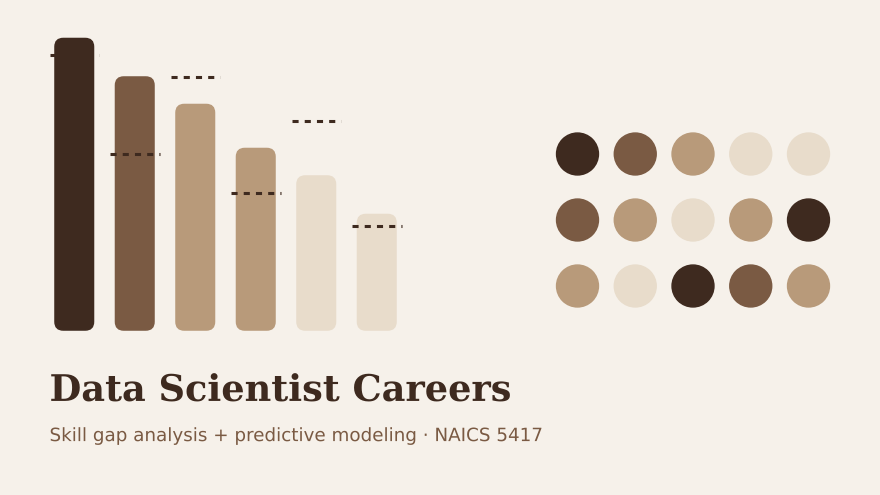
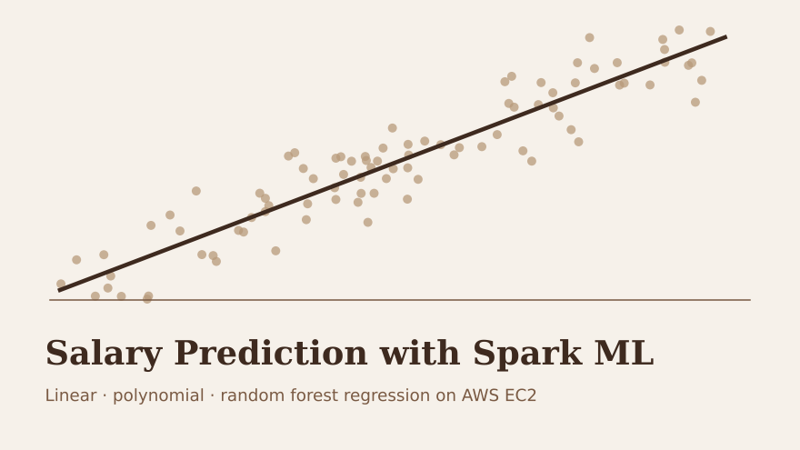
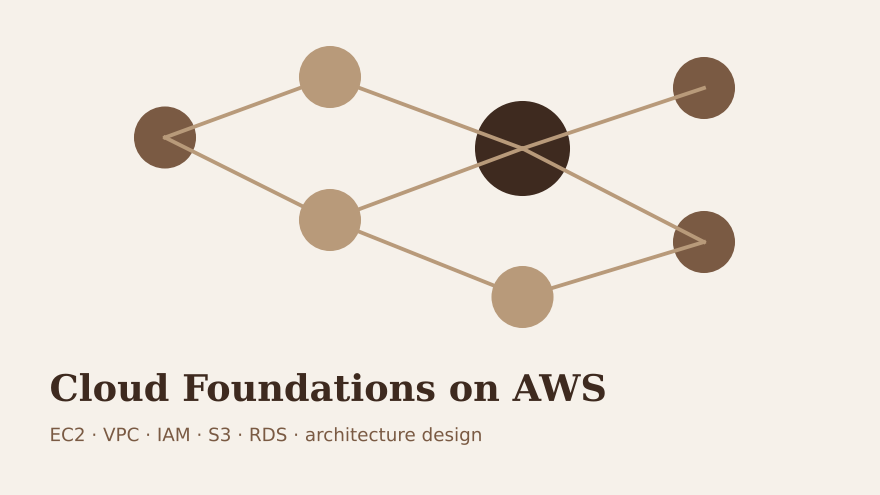
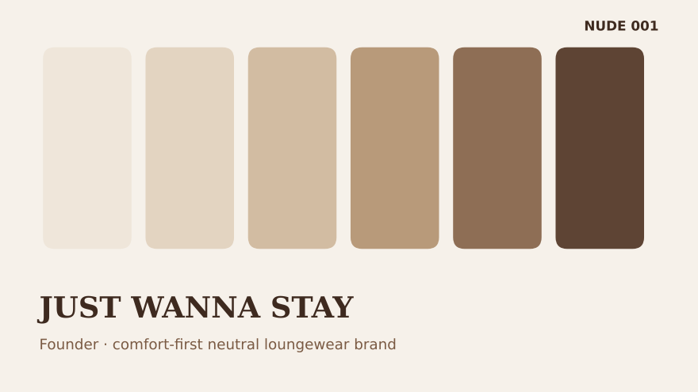

::: {.project-grid}

::: {.project-card}
{fig-alt="Cover graphic for the Data Scientist careers project"}

### Data Scientist Careers: Skill Gaps & Prediction

Team project (AD688, Group 5) analyzing job postings for Data Scientist roles in Professional,
Scientific & Technical Services (NAICS 5417). I led the **skill gap analysis**, comparing
the skills employers ask for with what candidates bring, and the **predictive modeling** section,
using Spark ML to model what drives salary.

**Tools:** PySpark · Spark ML · Plotly · Quarto · AWS EC2

[GitHub](https://github.com/toriiloukas){.btn .btn-outline-primary .btn-sm}
:::

::: {.project-card}
{fig-alt="Cover graphic for the salary prediction project"}

### Salary Prediction with Spark ML

Built a full machine learning pipeline on the Met Career Compass job postings dataset: cleaning,
feature engineering with `StringIndexer`, `OneHotEncoder` and `VectorAssembler`, then training
**linear, polynomial and random forest regression** models. I compared them on RMSE, R², AIC and
BIC, diagnosed multicollinearity in the linear models, and visualized feature importance and
actual vs. predicted values.

**Tools:** PySpark · Spark ML · Seaborn · Plotly · AWS EC2

[GitHub](https://github.com/toriiloukas){.btn .btn-outline-primary .btn-sm}
:::

::: {.project-card}
{fig-alt="Cover graphic for the AWS cloud foundations project"}

### Cloud Foundations on AWS

Completed the AWS Academy cloud curriculum alongside AD688. I configured and secured
**EC2** instances, built a **VPC** with a web server, set up **IAM** permissions, worked with
**EBS, S3 and RDS**, and designed a highly available, fault-tolerant architecture. All of my
Spark work for the course runs on a remote EC2 instance.

**Tools:** AWS EC2 · VPC · IAM · S3 · RDS · CloudWatch · Linux

[GitHub](https://github.com/toriiloukas){.btn .btn-outline-primary .btn-sm}
:::

::: {.project-card}
{fig-alt="Neutral color swatches for the JUST WANNA STAY brand"}

### JUST WANNA STAY: Founder

My own clothing brand: comfort-first, neutral-toned loungewear and everyday essentials with
subtle tonal embroidery. I'm handling brand development, the website and social presence, and
planning a preorder launch for the first collection, **NUDE 001**.

**Tools:** Brand strategy · Squarespace · Instagram · Photography

[Website](https://justwannastay.com){.btn .btn-outline-primary .btn-sm}
[Instagram](https://www.instagram.com/justwannastay_){.btn .btn-outline-secondary .btn-sm}
:::

:::
